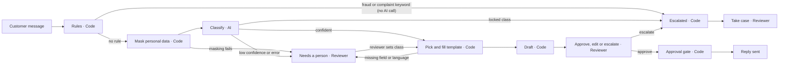

# Support Triage Agent

An unofficial pitch demo of a support triage agent for a bank, built on synthetic data only. It is not a production system: no authentication, no real customer data, no security review.

Code rules run first, a model only classifies, replies come from approved templates, and a person approves every reply before it is sent.

## Quickstart

1. `docker compose up --build`
2. Open http://127.0.0.1:8000
3. Click a "Send a test message" button and follow the trail on the card.

Without Docker, with [uv](https://docs.astral.sh/uv/) (offline, fake model, no keys):

```
uv sync
uv run python -m triage_agent serve             # console on http://127.0.0.1:8000
uv run python -m triage_agent eval --split dev  # evaluation set, report in eval/results/
uv run python -m triage_agent classify "<text>" # masked text and model result
uv run pytest
```

Real model: set `$env:OPENAI_API_KEY` and `$env:TRIAGE_PROVIDER = "openai_main"` in the terminal, then start as above.



**Where to look:** the System tab (http://127.0.0.1:8000/system) shows the flow, the active settings and model chain, the classes and rules, and why each control exists. It is read-only.

## How Finom adapts it

| What to change | Where |
| --- | --- |
| Classes, priorities, teams, deadlines, locked classes | `pack/taxonomy.yaml` |
| Keyword and regex rules (they always escalate) | `pack/rules.yaml` |
| Approved reply templates, per language | `pack/templates/<lang>/<id>.md` |
| Threshold, allowed template fields, AI-disclosure line | `pack/settings.yaml` |
| Models, fallback order, temperature, max_tokens, timeout | `pack/models.yaml`, or `TRIAGE_PROVIDER` |
| Another model API | a `TextModel` adapter in `src/triage_agent/providers/` |
| Ticket system | a `TicketSource` adapter (`src/triage_agent/ticket_source.py`) |
| Case storage (default SQLite) | a `CaseStore` adapter (`src/triage_agent/store.py`) |
| Test messages, eval tickets | `pack/scenarios.yaml`, `eval/tickets.jsonl` |

The config is validated on every start; restart and check that the config version on the System page changed.

## Results

gpt-4o-mini on the 38 held-out test tickets: 0 of 11 fraud and complaint tickets drafted, 0 PII leaks, 37 of 38 classes correct. 100 synthetic tickets written by an LLM; see [docs/project.md](docs/project.md) for limits.

- The tickets are synthetic; real messages will be messier.
- The sets are small: with 0 failures in 11 tickets, the true rate could still be up to about 3/11.
- Only structured personal data (IBAN, card, email, phone) is masked and measured; names and addresses are not.
- The model's confidence is uncalibrated; safety comes from rules, locked classes and the approval gate.

Before production: see the checklist in [docs/project.md](docs/project.md). Demo video: (link to be added)

## Repo layout

```
src/triage_agent/   pipeline, rules, approval gate, audit log, masking, evaluation, CLI
  providers/        model adapters (OpenAI-compatible, Anthropic)
  web/              console: Review and System pages (server-rendered, no JavaScript)
pack/               classes, rules, settings, templates, scenarios, models
eval/               100 evaluation tickets, baseline, reports
tests/              tests and the 15 console fixture tickets
docs/project.md     design, results, decisions
Dockerfile, docker-compose.yml, .github/workflows/ci.yml
```
