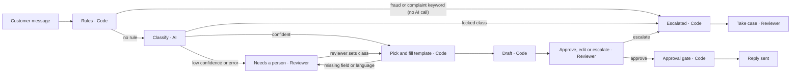

# Support Triage Agent

An unofficial pitch demo of a support triage agent for a bank, built on synthetic data only. It is not a production system.



```
uv sync
uv run pytest
uv run python -m triage_agent serve   # reviewer console on http://127.0.0.1:8000
uv run python -m triage_agent demo    # same flow on the command line
```

Design, scope and plan: [docs/project.md](docs/project.md)
