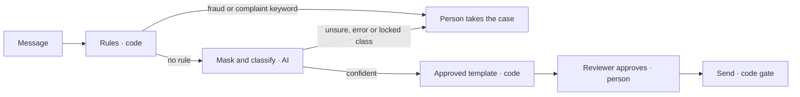

# AI Support Triage

A demo that sorts a bank's customer messages and drafts replies. Code applies the rules, an AI model only labels the message, and a person approves every reply. Synthetic data only. Unofficial demo, not a production system.

## How it is used

1. A customer message arrives.
2. Rules check it first. Fraud and complaint keywords go straight to a person, with no AI call.
3. Otherwise IBANs, card numbers, emails and phone numbers are masked, and the AI picks a class (card blocked, pending transfer, fee question, ...).
4. Code fills the approved reply template for that class. If a required detail is missing, the message goes to a person instead.
5. A reviewer approves, edits or escalates. Only then is the reply sent.

The console has three tabs: **Setup** (how it works, read-only), **Review** (the daily queue) and **Monitor** (counts and the latest evaluation).

## Why it is useful

- **Risky cases reach a person first.** No fraud or complaint ticket got a draft in any run (28 tickets, two models, 16 eval runs).
- **Routine questions arrive as ready drafts:** one click to approve.
- **Drafts use approved templates only,** reviewer edits are logged, and every step is in the audit log.
- **Seeded IBANs, card numbers, emails and phone numbers never reached a model** (0 leaks in the eval).

Class accuracy on 38 unseen test tickets: 0.947–0.974 with gpt-4o-mini (5 runs) and 0.895 with Claude Haiku (3 runs). The models fail differently, and the safety result is the same for both. Details: [docs/project.md](docs/project.md).

## How it is built



- Python, FastAPI and SQLite in one container.
- Model adapters for OpenAI-compatible APIs (also local servers) and Anthropic, with a fallback chain.
- Classes, rules, templates and settings are plain files in `pack/`, validated on every start.
- The AI cannot send, choose actions or call tools. If it fails, rules and the human queue still work.

## Compliance and privacy

Built with GDPR, the EU AI Act and DORA in mind (personal data masked before model calls, human approval of every reply, an AI-disclosure line, an audit log without message text), but it is not a compliance sign-off: it uses synthetic data only, and names and addresses are not masked.

## Run and adapt

```
docker compose up --build    # console at http://127.0.0.1:8000, offline test model
```

Without Docker: `uv sync`, then `uv run python -m triage_agent serve`. For a real model, set `OPENAI_API_KEY` and `TRIAGE_PROVIDER=openai_main` in your shell (provider ids are in `pack/models.yaml`). Evaluate with `uv run python -m triage_agent eval --split dev` (add `--provider openai_main` for a real model).

It runs on your own infrastructure: one container and SQLite; the only outside service is the model you choose. With a local model (any OpenAI-compatible server such as Ollama or vLLM, set via `base_url`), no message leaves your network. Hosted models need an EU endpoint, a data-processing agreement and zero-retention settings.

| To change | Where |
| --- | --- |
| Classes, deadlines, locked classes | `pack/taxonomy.yaml` |
| Keyword rules | `pack/rules.yaml` |
| Reply templates, per language | `pack/templates/<lang>/` |
| Threshold, allowed fields, AI note | `pack/settings.yaml` |
| Models and fallback order | `pack/models.yaml` |
| Ticket system or database | a `TicketSource` or `CaseStore` adapter in `src/triage_agent/` |

Restart after a config change and check that the config version on Setup changed. Run `eval` on your own labeled tickets before you trust it.

## Limits

- The tickets are synthetic and few (38 test tickets); real messages will be messier. They were written by a Claude agent, so the Claude Haiku result is likely optimistic; gpt-4o-mini is the cross-family result.
- No login, security review or load test. The local-model path is tested with mocked HTTP only.
- A wrong-class draft can still reach the reviewer, who approves every reply.

Before production: see the checklist in [docs/project.md](docs/project.md). Demo video: (link to be added)
