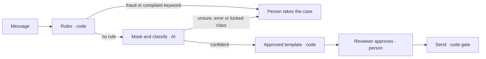

# AI Support Workflow

A demo that sorts a bank's customer messages and drafts replies. Rules handle the risky cases, an AI model only picks a category, and a person approves every reply. Synthetic data only.

## How it works

1. A customer message arrives.
2. Simple rules check it first. Fraud or complaint words go straight to a person, with no AI involved.
3. Personal data is masked. Then the AI picks a category, such as "card blocked" or "fee question".
4. The system fills in the approved reply for that category.
5. A reviewer approves, edits or escalates. Only then is the reply sent.

The console has three tabs: **Setup** (how it is configured), **Review** (the daily queue) and **Monitor** (counts and the latest evaluation).



## Why it helps

- **Faster.** Routine questions arrive with a category and a ready reply.
- **Safe.** The AI cannot send, choose actions or call tools. If it fails, the rules and the human queue still work.
- **Easy to change.** Categories, keyword rules and reply templates are plain files. No code changes needed.
- **Traceable.** Every step is logged.

**Results:** on 38 unseen test tickets, the right category was picked 95–97% of the time with gpt-4o-mini (5 runs) and about 90% with Claude Haiku (3 runs). No personal data reached a model. Details: [docs/project.md](docs/project.md).

## Run it

```
docker compose up --build    # console at http://127.0.0.1:8000, offline test model
```

Without Docker: `uv sync`, then `uv run python -m triage_agent serve`.

For a real model, set `OPENAI_API_KEY` and `TRIAGE_PROVIDER=openai_main` (provider ids are in `pack/models.yaml`).

To evaluate: `uv run python -m triage_agent eval --split dev` (add `--provider openai_main` for a real model).

## Adapt it

| To change | Where |
| --- | --- |
| Categories, deadlines, locked classes | `pack/taxonomy.yaml` |
| Keyword rules | `pack/rules.yaml` |
| Reply templates, per language | `pack/templates/<lang>/` |
| Threshold, allowed fields, AI note | `pack/settings.yaml` |
| Models and fallback order | `pack/models.yaml` |
| Ticket system or database | a `TicketSource` or `CaseStore` adapter in `src/triage_agent/` |

After a config change, restart and check that the config version on Setup has changed. Run `eval` on your own labeled tickets before you trust it.

## Privacy and compliance

Built with GDPR, the EU AI Act and DORA in mind: personal data is masked before any model call, a person approves every reply, replies carry an AI-disclosure line, and the audit log contains no message text.

It runs on your own infrastructure (Python, FastAPI and SQLite in one container). With a local model (any OpenAI-compatible server such as Ollama or vLLM), no message leaves your network. Hosted models need an EU endpoint, a data-processing agreement and zero-retention settings.

## Limits

- Few tickets, all synthetic (38 test tickets).
- Names and addresses are not masked.
- No login, security review or load test. The local-model path is tested with mocked HTTP only.
- A wrong-category draft can still reach the reviewer, who approves every reply.

Before production, see the checklist in [docs/project.md](docs/project.md).
