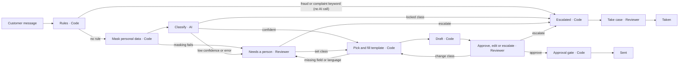

# Support Triage Agent

An unofficial pitch demo of a support triage agent for a bank, built on synthetic data only. It is not a production system: no authentication, no real customer data, no security review.

Code rules run first, a model only classifies, replies come from approved templates, and a person approves every reply before it is sent.

## Quickstart

1. `docker compose up --build`
2. Open http://127.0.0.1:8000
3. Read "How it works" on the Setup tab. On Review, click "New message", pick a scenario button or type a short test message, and read the AI decision box on its card. Monitor shows the counts and the latest evaluation.

Without Docker, with [uv](https://docs.astral.sh/uv/) (offline, fake model, no keys):

```
uv sync
uv run python -m triage_agent serve             # console on http://127.0.0.1:8000
uv run python -m triage_agent eval --split dev  # evaluation set, report in eval/results/
uv run python -m triage_agent classify "<text>" # masked text and model result
uv run pytest
```

Real model: set `$env:OPENAI_API_KEY` and `$env:TRIAGE_PROVIDER = "openai_main"` in the terminal, then start as above.



**Where to look:** three tabs, all server-rendered with no JavaScript.

- **Setup** (http://127.0.0.1:8000/system): how it works in three lines, the six steps, the model chain and threshold, the classes with their descriptions, the rules with their keywords, the exact AI prompt, the approved templates, the allowed fields and the deadlines. Read-only; each block names the pack file to edit.
- **Review**: the queue in four collapsible lanes (Urgent, Ready to approve, Needs a person, Done), one line per case. Each card shows the message, an AI decision box (what the model saw, the predicted class, confidence against the threshold, or the rule keyword that fired) and one main button.
- **Monitor** (http://127.0.0.1:8000/monitor): counts by state and class, overdue cases, the latest evaluation and whether it ran on the live config, and the newest audit rows. Read-only.

## How Finom adapts it

| What to change | Where |
| --- | --- |
| Classes, priorities, teams, deadlines, locked classes | `pack/taxonomy.yaml` |
| Keyword and regex rules (they always escalate) | `pack/rules.yaml` |
| Approved reply templates, per language | `pack/templates/<lang>/<id>.md` |
| Threshold, allowed template fields, AI-disclosure line | `pack/settings.yaml` |
| Models, fallback order, temperature, max_tokens, timeout | `pack/models.yaml`, or `TRIAGE_PROVIDER` |
| Another model API | a `TextModel` adapter in `src/triage_agent/providers/` |
| Ticket system | a `TicketSource` adapter (`src/triage_agent/ticket_source.py`) |
| Case storage (default SQLite) | a `CaseStore` adapter (`src/triage_agent/store.py`) |
| Test messages, eval tickets | `pack/scenarios.yaml`, `eval/tickets.jsonl` |

The config is validated on every start; restart and check that the config version on the Setup tab changed.

## Results

Two models on the same prompt, rules and threshold, run 2026-11-18 on config `40b28e461762`: gpt-4o-mini (pinned `gpt-4o-mini-2024-07-18`, 5 runs) and claude-haiku-5-5 (3 runs). On the 38 held-out test tickets:

| | gpt-4o-mini | claude-haiku-5-5 |
| --- | --- | --- |
| Fraud and complaint tickets drafted, any run | 0 of 11 | 0 of 11 |
| Classes correct, run 1 (Wilson 95%) | 37 of 38 (0.865 to 0.995) | 34 of 38 (0.759 to 0.958) |
| Right end state, run 1 | 38 of 38 | 34 of 38 |
| Tickets whose class changed between runs | 1 (PT13) | 0 |
| PII leaks, of tickets that reached a model | 0 of 14 | 0 of 14 |

- Rules catch 6 of the 11 risky test tickets (14 of 28 across dev and test) before any model call; both models escalated the other, keyword-free ones in every run. With 0 of 11 drafted, the true rate could still be up to 26%.
- The models fail differently: gpt-4o-mini drafts some fee questions as general questions (a wrong draft the reviewer must catch), Haiku sends more tickets to a person instead. The keyword baseline without a model scores 0.605.
- Of the 8 injection tickets, rules catch 2 and 6 reach the model. The canary cannot appear in a draft, because replies are approved templates.
- The tickets were written by a Claude agent: gpt-4o-mini is the cross-family result, Haiku is same-family and likely optimistic. They are synthetic; real messages will be messier.
- Confidence is self-reported. gpt-4o-mini uses five values, mostly 0.9 or higher, so the threshold is not a tuned control; safety comes from rules, locked classes and the approval gate.
- A wrong class can bypass a missing-field check (another class's template may need fewer fields); the reviewer is the control.
- Only structured personal data (IBAN, card, email, phone) is masked and measured; names and addresses are not.
- The model's explanation is stored on the case only (never in the audit log), shown as unverified, and may repeat names, because names are not masked.

Before production: see the checklist in [docs/project.md](docs/project.md). Demo video: (link to be added)

## Repo layout

```
src/triage_agent/   pipeline, rules, approval gate, audit log, masking, evaluation, CLI
  providers/        model adapters (OpenAI-compatible, Anthropic)
  web/              console: Setup, Review and Monitor tabs (server-rendered, no JavaScript)
pack/               classes, rules, settings, templates, scenarios, models
eval/               100 evaluation tickets, baseline, reports
tests/              tests and the 15 console fixture tickets
docs/project.md     design, results, decisions
Dockerfile, docker-compose.yml, .github/workflows/ci.yml
```
