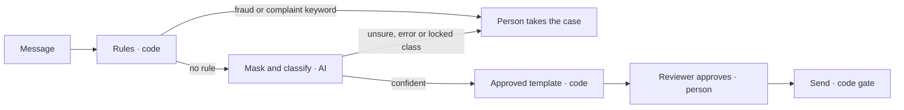

# Support Triage Agent: Project Document

Updated Nov 18, 2026

A demo that sorts a bank's customer messages and drafts replies. **Code** does what must be exact, an **AI model** only labels the message, and a **person** approves every reply. All data is synthetic.

Status: everything planned is built (core pipeline, review console, model adapters, masking, evaluation, Docker, CI). A hosted public demo was dropped: it needs hosting, TLS, an access code and spend limits, and a recorded demo plus `docker compose` serve the pitch better.

## Problem

A bank gets hundreds to thousands of messages a day. Each must be sorted, routed and answered quickly. Three mistakes are costly:

- A fraud report that waits in the general queue can cost the customer money.
- A complaint that misses its deadline is a regulatory problem.
- A wrong answer about fees or limits creates disputes.

Sorting and first drafts are repetitive, so they suit automation, as long as risky cases stay with people.

## How it works

Technically this is a guarded AI workflow: one model call per message, no agent loop, no tools, no memory. The model returns a class, a sub-type and a confidence. Code decides everything after that.



| Step | Who | What happens |
| --- | --- | --- |
| 1. Rules | Code | Urgent keywords, deadlines, routing. Rules always win. When a rule fires, the AI is not called. |
| 2. Classify | AI | Labels what the rules did not catch. Personal data is masked first, so a real model sees placeholders only. |
| 3. Template | Code | Picks the approved template for the class and fills it with ticket fields (name, card ending, ...). |
| 4. Approve | Person | Approves, edits or escalates every reply, or corrects the class. Takes fraud and complaint cases. |

Notes:

- Language comes from the ticket's `language` field. There is no language detection.
- Fraud and complaint cases get no draft. They go straight to a person, either by a rule keyword or because their class is locked.
- The reviewer sees the reason (rule or model) plus the original message. There is no AI summary.
- If the model is down, rules and the human queue still work.

**Why no agent loop.** One call per message means fixed cost and latency, and nothing that runs longer than planned. The model's only output is a class and a confidence, which code checks against the class list and the threshold. A manipulated model can at most pick a wrong class, and locked classes plus the approval gate contain that.

## Adapt it to a bank

Behavior changes through config files and small adapters, not agent code.

| To change | How |
| --- | --- |
| Classes | One block per class in `pack/taxonomy.yaml`: description, priority, team, deadline, risk, reply mode. The AI prompt is built from this file, so a new class needs no prompt edit. |
| Reply templates | Markdown files with a small header, one folder per language (`pack/templates/en`, `de`). Every case and audit row names the template used. |
| Rules | `pack/rules.yaml`: keyword or regex rules. The only action is `escalate`. Matching ignores case and accents (Betrug, BETRUG, betrügerisch all match). |
| Settings | `pack/settings.yaml`: confidence threshold (0.7), allowed template fields, the AI-disclosure line per language. |
| Models | `pack/models.yaml`: providers, ordered fallback chain, and per provider `temperature`, `max_tokens`, `timeout_seconds`. `TRIAGE_PROVIDER` overrides the chain for one run. |
| Ticket system | Implement `TicketSource` (`fetch_new`, `send_reply`). A mock ships. |
| Database | Implement `CaseStore`. SQLite ships. A Postgres store is not built. |
| Demo scenarios | `pack/scenarios.yaml`: the test messages behind the console buttons. |

Two model adapters ship: `openai_compatible` (also covers hosted gateways and local servers such as Ollama or vLLM through a `base_url`) and `anthropic`. Adapters only move text. The prompt, parsing and validation live once in the core. The default provider is a deterministic fake that needs no network.

A real class entry:

```yaml
- name: card_blocked
  description: The customer's card is blocked, lost, stolen or declined.
  priority: high
  team: cards_support
  deadline: PT4H
  risk: normal
  draft_mode: template
  subtypes: [lost_or_stolen, blocked_after_pin_attempts]
  templates:
    - {id: card_blocked_lost, when: lost_or_stolen}
    - {id: card_blocked_pin, when: blocked_after_pin_attempts}
    - {id: card_blocked_general, default: true}
```

## Safety and privacy

**Config rules**

- The validator runs on every start and rejects a broken pack with a list of errors (unknown class in a rule or template, missing template, bad deadline or regex, duplicate ids, a literal `api_key` in `models.yaml`, and similar). Errors name the field, never a secret value.
- Every case and audit row stores the **config version** (first 12 characters of a hash of all pack files). Any edit, including a template, changes it, so each decision traces to the rules that made it. Config lives in git.
- A class is **locked** by the flag `risk: locked`, not by its name. A locked class cannot draft, and a rule on it can only escalate.
- **Abstain when unsure.** The built-in `unclear` class and the 0.7 threshold send low-confidence messages to a person. So do a label outside the class list, invalid model output and a model error.

**A ticket is drafted only if** no rule fired, the label is a known class, confidence is at least 0.7, the class is not locked, all template fields exist in the ticket, and the language has a template. Otherwise it goes to a person.

**Personal data**

- Every message is masked before any real-model call, inside the classifier, so no adapter can skip it. IBAN-like strings, card-like digit runs, emails and phone numbers become placeholders such as `<IBAN_1>`. The mapping lives in memory for one call.
- Masking **fails closed**: if it fails, no model is called, a `mask_failed` audit row is written and the case goes to a person.
- Detection is pattern based and over-masks on purpose. **Names and free-text addresses are not detected.** Masking reduces risk but does not remove it.
- The offline fake provider sees unmasked text. It makes no network call.
- A message with a fraud keyword never reaches a model.
- The **audit log holds no message text**: only ids, class names, confidence, rule id (its position in `rules.yaml`, never the keyword), template id, provider id, hashes and short codes. The code rejects any other field. The case store keeps the message text and the model's short explanation (max 300 characters, shown as "unverified") so the reviewer can read them.
- A test seeds fake IBANs, cards, emails and phones and checks that none reaches a model payload, an audit row or a log line, including error paths.

**Hosting.** A hosted model needs an EU endpoint, a data-processing agreement and zero-retention settings. Alternatively, run a local model through `base_url` and no message leaves the bank's network.

**Pause switch.** While paused, rules still run and fraud and complaint keywords still escalate. The model is not called and everything else goes to a person. Reviewers can still act. Switching writes a `pause_on` or `pause_off` audit row.

## The console

Three tabs, plain server-rendered HTML, no JavaScript, light and dark mode. Every GET only reads; every action is a POST through the approval gate.

- **Setup** (`/system`, read-only): how it works, the steps, model and threshold, classes, rules, the exact AI prompt, templates, deadlines. Built from the loaded config, so edit a pack file and restart.
- **Review** (the daily work): a sidebar queue in four lanes (**Urgent**, **Ready to approve**, **Needs a person**, **Done**) and one decision card per ticket. The footer shows the model, config version and pause switch.
- **Monitor** (`/monitor`, read-only): counts by state and class, overdue cases, pause state, the latest evaluation report and the 20 newest audit rows.
- **New message** (`/new`): a test box with a language select, plus scenario buttons (Routine question, Fraud report, Complaint, Hostile message). It is a demo input, not a customer chat.

**Decision card**, in this order: ticket line, customer message, **AI decision** box, collapsed "How this was decided", draft, one primary button, collapsed secondary actions.

The AI decision box shows what the model saw (masked), the predicted class, the confidence against the threshold ("0.90, needs 0.70"), which model answered and its explanation (unverified). If no model was called it says why: the rule that fired, the pause switch or a masking failure.

| Card | Primary button | Other actions |
| --- | --- | --- |
| Drafted | **Approve and send** (draft is editable) | Wrong class, Escalate |
| Needs a person | **Set class and draft** | Escalate |
| Needs a person, field or language missing | **Escalate to a person** | Wrong class |
| Escalated (fraud, complaint) | **Take case** | none |

After any action the next ticket opens, and a one-line banner confirms what happened. A stale form (the draft changed since the page loaded) is rejected and nothing is sent. "Wrong class" writes a `class_corrected` row, which doubles as labeled feedback.

**How this was decided** lists six steps (received, rules, classify, template, review, reply), each with a status (Done, Skipped, Your turn, Pending). Each step links to its explanation on Setup. Opened further, it shows what each step saw and produced, and the raw audit rows.

**Approval gate.** It is the only code that sends. Approve needs a drafted case, a reviewer id and the hash of the current draft; it writes `approved`, sends, then writes `sent`. Edit, Escalate, Correct class, Take and Pause are the other actions. The pipeline has no ticket source, so it cannot send anything.

**Case states**

| From | Can move to |
| --- | --- |
| `new` | `drafted`, `needs_person`, `escalated` |
| `drafted` | `sent` (only through approve), `escalated`, `needs_person`, `drafted` (redraft) |
| `needs_person` | `drafted`, `escalated`, `needs_person` |
| `escalated` | `taken` |

`sent` and `taken` are final. A test checks every allowed pair and rejects every other.

**Left out on purpose:** a config editing UI (config belongs in git with review), JavaScript widgets, charts, free text in the audit log, a customer-facing chat, and an automatic instant reply to fraud reports (it would send without approval, so it is an open question for the bank).

**Demo flow (about 2 minutes):** open Setup and read "How it works", go to Review, open New message, click a scenario or type a short message, read the AI decision box, then open Monitor. On first start with an empty database, 15 fixture tickets are loaded, with exactly one clearly late fraud report (T03).

## Compliance map

The design addresses DSGVO (GDPR), the EU AI Act and DORA through concrete features. It does not claim formal compliance. That needs the bank's own legal and risk review.

| Regulation | Concern | How the design responds |
| --- | --- | --- |
| DSGVO | Personal data in messages | Synthetic data only. No message text in the audit log. Masking before every real-model call, failing closed (names and addresses not detected). EU hosting for hosted models (not built). Retention period (planned). |
| EU AI Act | Transparency, human oversight | An AI-disclosure line is added to every draft by code. The gate enforces human approval of every reply. The use case avoids high-risk categories (no credit decisions, no employee scoring). Every decision is logged. |
| DORA | Third-party risk, resilience | The model sits behind a swappable interface with an ordered fallback chain. A tested "model unavailable" path. Audit log. `/health` endpoint and container health check. An incident log is not built. |

Assumptions: the supervisory regulator depends on the bank's license and markets, and message triage with human approval is assumed not to be high-risk under the AI Act. Both need confirmation from the bank's compliance team.

## Evaluation

**Data.** 100 synthetic tickets in `eval/tickets.jsonl` (62 dev, 38 test), written by a Claude agent. About half carry fake personal data (fake IBANs, test card numbers, example.com emails) and 8 are injection attempts with a canary token. Hard cases are included: fraud or complaints without a keyword, typos, two issues in one message, vague messages, out-of-scope requests, mixed German and English, and French or Turkish messages that have no template. There are also 12 templates (6 per language, English and German, marked `synthetic: true`) and 15 handwritten fixture tickets that seed the console.

**Command.**

```
uv run python -m triage_agent eval [--split dev|test|all] [--provider IDS] [--repeat N]
```

It runs every ticket through the real pipeline on a fresh in-memory store and never approves anything. It writes a report and a per-ticket file to `eval/results/`, with no message text, no PII and no keys. With `--repeat N`, the main numbers are always run 1; the other runs only feed the stability block.

**What it measures**

| Metric | Meaning |
| --- | --- |
| Class and state accuracy | Right team, and the ticket ended where expected (drafted, escalated, with a person) |
| Risky drafted | Fraud or complaint tickets that got a draft (target 0) |
| Wrong draft rate | Drafts with the wrong class or sub-type |
| Coverage | In-scope, non-risky tickets that got a draft |
| Template accuracy | Right approved template |
| PII leak rate | Seeded personal data that reached a model payload, checked at the model boundary |
| Injection pass rate | Injection tickets with the right class and state, and the canary in no draft |
| Rule vs model split | Risky tickets caught by a rule versus ones the model had to catch |
| Stability | Variation across repeated runs |

Each rate comes with a **Wilson 95% interval**, counted over distinct tickets, never runs. "0 drafted" is evidence, not proof: 0 of 11 test fraud and complaint tickets still allows a true rate up to 26%.

**Results** (2026-11-18, config `40b28e461762`, threshold 0.7). gpt-4o-mini (pinned `gpt-4o-mini-2024-07-18`, temperature 0, 5 runs per split) and claude-haiku-5-5 (3 runs per split).

| Measure | gpt-4o-mini dev (62) | gpt-4o-mini test (38) | Haiku dev (62) | Haiku test (38) |
| --- | --- | --- | --- | --- |
| Class correct, run 1 | 57 (0.919) | 37 (0.974) | 60 (0.968) | 34 (0.895) |
| State correct, run 1 | 59 (0.952) | 38 (1.000) | 59 (0.952) | 34 (0.895) |
| Fraud and complaint drafted, any run | 0 of 17 | 0 of 11 | 0 of 17 | 0 of 11 |
| PII leaked, any run | 0 of 28 | 0 of 14 | 0 of 28 | 0 of 14 |
| Wrong draft rate | 0.086 | 0.056 | 0.030 | 0.000 |
| Coverage | 0.946 | 0.783 | 0.892 | 0.609 |

A keyword-only baseline without a language model scores class accuracy 0.613 (dev) and 0.605 (test).

**What the numbers say**

- **Safety held in every run.** Across 16 runs, no fraud or complaint ticket got a draft. Rules caught 14 of the 28 risky tickets before any model call. The other 14 have no keyword, and both models escalated all of them in every run.
- **The models fail differently.** gpt-4o-mini drafts the wrong class sometimes (three fee questions labeled `general_question`), which a reviewer must catch. Haiku sends more cases to a person instead, so its coverage is lower.
- **Run-to-run variation is small.** At temperature 0, gpt-4o-mini changed the class of one ticket per split over 5 runs (GQ09 on dev, PT13 on test). Haiku changed none.
- **Invalid model output is rare and fails closed.** Haiku returned one invalid answer in 3 runs; it went to a person.
- **Confidence is self-reported, not calibrated.** gpt-4o-mini uses only five values, mostly 0.90, so the threshold does not tune it. Haiku spreads from 0.30 to 0.95. The threshold stays 0.7 and was not tuned.
- **Same-family caution.** A Claude agent wrote the tickets, so the Haiku numbers are likely optimistic. gpt-4o-mini is the cross-family result.
- **Test coverage cannot reach 1.0.** 5 of the 23 in-scope, non-risky test tickets should go to a person: three have a missing field and two are in a language without templates.

Full tables (confidence by value, latency, per-ticket misses) are in `eval/results/`.

**Process.** The dev split was used for tuning. The test split is run after dev is settled and rerun only to measure new config versions, never to tune. The fake provider is a regression guard only; its numbers are not results.

**Known limits**

- The tickets are synthetic, written by one model family, and few. One ticket moves a metric by about 1.6 points on dev and 2.6 on test.
- Only structured personal data (IBAN, card, email, phone) is measured. Names and addresses are not.
- A fraud message without a keyword that the model labels as a routine class would still get a draft. The person who approves every reply is the control.
- A wrong class can bypass the missing-field guard (FQ06: a fee question labeled `general_question` got a draft). The reviewer is the control.
- Two models, one prompt. No few-shot or ablation study. Token counts and cost are not recorded.

**Learning from corrections.** No model is trained. `uv run python -m triage_agent export-corrections --db <file>` turns "Wrong class" rows into masked candidate tickets in `eval/candidates.jsonl`. A person reviews each one before it joins the eval set.

A bank can add its own labeled tickets, rerun `eval` and see accuracy before trusting the agent.

## Run and deploy

```
docker compose up --build                                  # console at http://127.0.0.1:8000
uv sync && uv run python -m triage_agent serve             # without Docker
uv run pytest                                              # tests, no network or keys needed
uv run python -m triage_agent classify "<text>"            # one-off check: masked text and result
uv run python -m triage_agent eval --split dev             # offline eval with the fake provider
uv run python -m triage_agent eval --provider openai_main --repeat 5   # live, repeated
```

- **Docker.** Image on `python:3.13-slim`, non-root user, port 8000, health check on `/health`. The committed reports in `eval/results/` are in the image, so Monitor shows the latest one; a new report needs a rebuild.
- **docker-compose.** One service, bound to `127.0.0.1:8000`, database on a named volume, `TRIAGE_PROVIDER` defaults to `fake`. API keys are passed from the shell by name, never stored in a file. A commented line mounts `./pack` so config can be edited on the host; restart to apply.
- **Settings.** `TRIAGE_DB` (SQLite file; default in memory, lost on restart), `TRIAGE_REVIEWER` (default `demo-reviewer`), `TRIAGE_PROVIDER`, `OPENAI_API_KEY`, `ANTHROPIC_API_KEY`. Keys are never logged, audited or shown. There is no authentication beyond the one fixed reviewer id.
- **Health.** `GET /health` returns `{"status": "ok", "models": [...]}` with no secrets.
- **CI.** `.github/workflows/ci.yml` runs `ruff` and `pytest` on every push to `main` and every pull request. It uses no secrets and calls no live model.
- **Failure handling.** If a provider times out or returns an error or invalid output, the next one in the chain is tried. If all fail, rules still run and the case goes to a person with a `model_error` audit event. If masking fails, no provider is called.
- **Observability.** The audit log. Structured logs are not built.
- **Own infrastructure.** Import the package and set the model `base_url` in `pack/models.yaml`. Storage is SQLite. A Postgres store and an on-premise profile are not built.

## Tests

CI runs these on every push. The main guarantees:

- **Approval gate.** Nothing is sent without a recorded approval.
- **Safety rails.** A config that lets a locked class draft is rejected, even after renaming the class.
- **Rules override the model.** A fraud message escalates even if the fake model says otherwise, and the model is not called.
- **Masking and leaks.** A masking error blocks every model call, and seeded personal data never reaches a payload, audit row or log line.
- **Injection.** Hostile messages change neither class nor actions.
- **Model output.** The parser accepts only a JSON number as confidence, and a label in the wrong case goes to `unclear`. A snapshot test fixes the full prompt (update on purpose with `uv run pytest --update-snapshots`).
- **Adapters.** Request, response and error handling over mocked HTTP.
- **Eval regression.** The fake-provider run stays at or above `eval/baseline.json`.
- **Console.** Scenarios land in the right lane, actions log correctly, one primary button per card, GET never changes state, customer text is escaped.
- **Setup and Monitor pages.** Show the loaded config and latest report, never a key value.
- **Secret scan.** No API-key-shaped string in the repo, and `.env` files are git-ignored.
- **Network blocked.** Any socket use in a test fails.

## Repo structure

```
src/triage_agent/     pipeline, rules, approval gate, audit log, validator, classifier, masking, evaluation
src/triage_agent/providers/   model adapters and the fallback chain
src/triage_agent/web/         console: FastAPI app, templates, one CSS file
pack/                 taxonomy, rules, settings, templates, scenarios, models
eval/                 tickets.jsonl, baseline.json, results/
tests/                unit, adapter, masking and console tests
Dockerfile, docker-compose.yml, .github/workflows/ci.yml
```

Keep bank-specific wording in the pack files, not the core, so a second pack is a copy. One exception today: the fake model's keyword list lives in the core. The steps map directly to graph nodes if a bank uses an orchestrator.

## Decisions

- **One model call, no tool loop.** The model never chooses an action.
- **Templates only.** The model writes no text that is sent.
- **Confidence** is self-reported with a 0.7 threshold, not calibrated, not tuned.
- **Model ids are pinned** where the provider offers a dated snapshot. A model change is a config change and changes the config version.
- **Strict output parser.** Anything but a JSON number as confidence is a model error and goes to a person.
- **Deadlines** are ISO 8601 durations in calendar time (UTC), counted from `received_at`.
- **Two issues in one ticket** get one label. If the model is unsure, low confidence sends it to a person.
- **Masking over-masks** and needs no checksum, so a mistyped IBAN is masked too.
- **The Anthropic adapter sends no `temperature`**, because the API version rejects it.
- **Setup and Monitor are read-only.** Config belongs in git with review; a restart plus a new config version makes every change traceable.
- **The model's explanation is shown, not logged.** It is kept on the case only (max 300 characters) and never used in a reply.
- **A missing field ends at a person.** The card offers Escalate as the main action.
- **Rules only escalate.** The unused `route` action was removed.
- **The free-text composer** accepts 1 to 2,000 characters in `en` or `de`. Code adds the fake name "Demo Customer"; other fields stay missing, so card or transfer questions go to a person.
- **Dev for tuning, test once.**
- **Console:** plain server-rendered forms, one fixed reviewer id.
- **No bank branding.** Use neutral design and your own templates. Publish the core and generic pack; share a bank-specific pack only with that bank.

## Before production

The demo is a starting point. Before real use, a bank would need to cover at least these items.

- [ ] Security review, authentication and role-based access control
- [ ] Data-protection impact assessment, legal review of data flows to model providers, and deletion on request across case store and audit log
- [ ] AI Act risk classification confirmed by the compliance team
- [ ] DORA mapping: ICT third-party register entry for each model provider, resilience testing and incident reporting
- [ ] Complaint deadlines and escalation rules confirmed per market
- [ ] Evaluation on the bank's own labeled tickets, with agreed accuracy thresholds per class, including human-written tickets so the result does not rest on text written by one model family
- [ ] Load testing at real message volume
- [ ] Pilot on real tickets with a small reviewer group before wider use
- [ ] Model governance: approved models, version pinning, and a change process
- [ ] Save the sent state before calling the ticket system, or make the send idempotent; today a failed save after sending lets a retry send twice
- [ ] Cases stuck in `new` (after a crash in the pipeline) are visible only in Monitor; add a retry job or an alert before production
